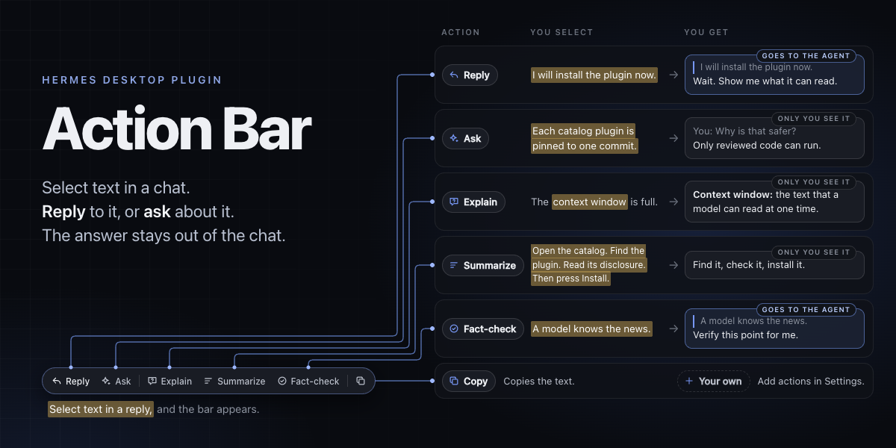
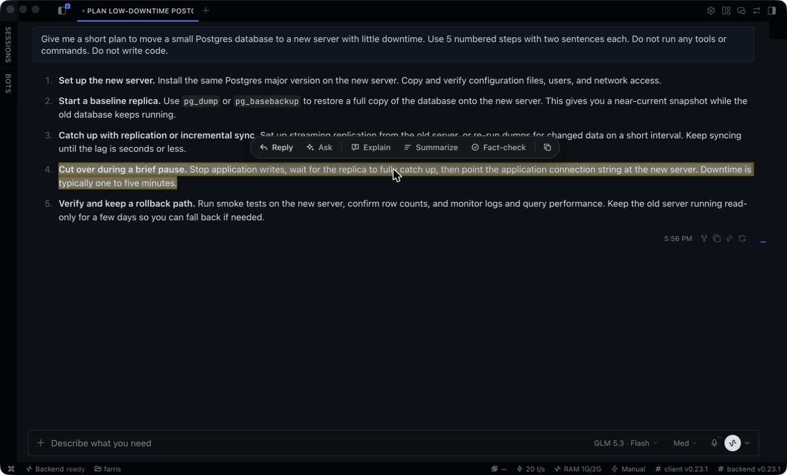
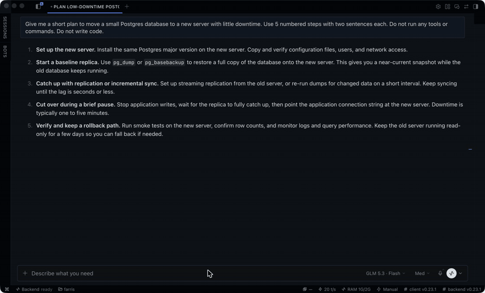
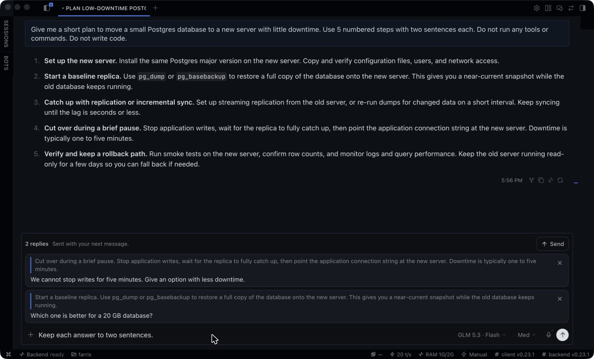
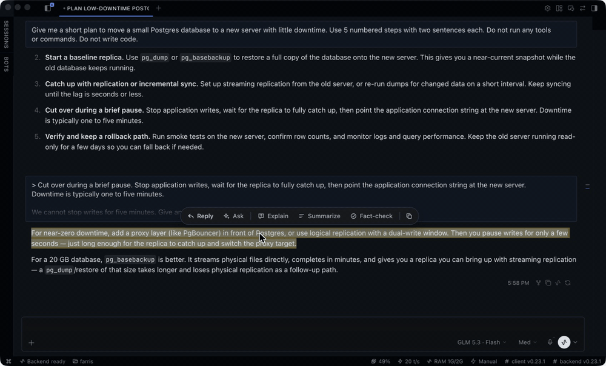
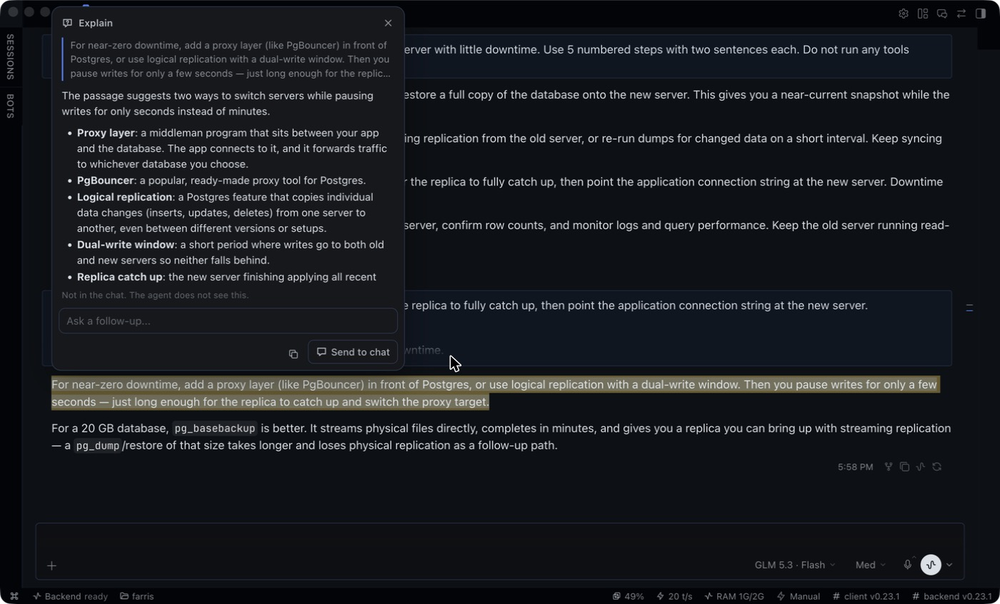
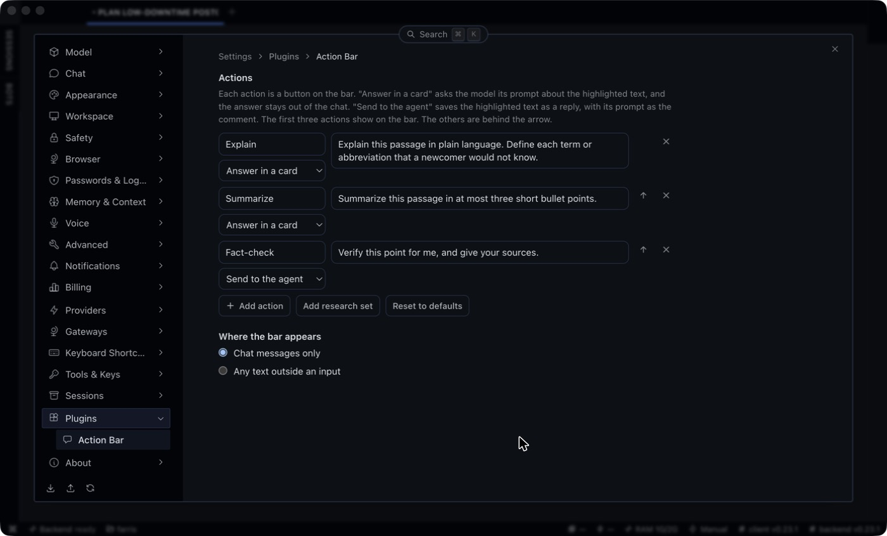

# Hermes Action Bar



The Hermes Action Bar is a selection bar for Hermes Desktop.
It is a plugin for a Hermes Agent user to better engage with their Hermes agent sessions.

Select text in a chat and a small bar appears, with two kinds of action:

1. **Reply | Fact-check**
   - Reply keeps the quote and one comment as a card above the composer.
   - On send, the cards go in front of your message as Markdown blockquotes.
     Several passages each get their own comment in one message.
   - Fact-check is a Reply with a ready comment: "Verify this point for me, and give your sources."
     The agent has tools, so it does the check in the chat.
2. **Ask | Explain | Summarize**
   - For a question that only the reader has.
     They open an "answer card" next to the highlight, with follow-up questions.
   - The answer does not enter the chat and the agent does not see it.
   - **Send to chat** puts it in the composer if it matters to the work.

Note: actions are a label, a prompt and a place: an answer card, or the agent.
You edit them on a settings page.
**Copy** is on the bar too, and it copies the selected text.



The banner at the top is an illustration with short examples.
The other images on this page show the plugin in Hermes Desktop 0.23.1.
The chat and the model answers in them are real.

## Why

I am always intrigued with making the harness and the desktop app experience better for myself and any user.
That is why I built this.
It grew from my earlier, smaller plugin for Hermes Desktop, [hermes-quote-selection](https://github.com/fquresh/hermes-quote-selection).

Hermes replies are long.
Most questions are about one sentence.

There are two types of question, and they need different places.

| Type | Example | Where it goes |
|---|---|---|
| The agent must act on it | "We cannot stop writes for five minutes. Give another option." | **Reply**, in the chat |
| You want to understand | "What is logical replication?" | An **answer card**, out of the chat |

A question of the second type does not belong in the chat.
It makes the history longer.
The agent reads it again on each later turn.
It can interrupt an agent that is in the middle of a task.
You also lose your place in the reply.

The answer card keeps that question next to the sentence.
If the answer matters to the work, **Send to chat** moves it into the composer.

## Use

### Reply

1. Select text in a reply.
2. Click **Reply**, or press **Cmd+Option+R** (Ctrl+Alt+R on Windows and Linux).
3. Type a comment and press Enter. The comment is optional.
4. Do this again for each passage that you want to answer.
5. Type your message in the composer and press Enter.

The agent gets each quote as a Markdown blockquote, with its comment below it, and then your message.

```
> Cut over during a brief pause. Downtime is typically one to five minutes.

We cannot stop writes for five minutes. Give an option with less downtime.

> Use pg_dump or pg_basebackup to restore a full copy of the database.

Which one is better for a 20 GB database?

Keep each answer to two sentences.
```



You can edit a comment or remove a reply in the strip above the composer.



The **Send** button on the strip sends the replies when the composer is empty.
Replies belong to the chat where you made them.

### Fact-check

1. Select a claim in a reply.
2. Click **Fact-check**. The quote goes to the strip above the composer, with the comment "Verify this point for me, and give your sources."
3. Press Enter. The focus is on the **Send** button of the strip.

The agent gets the quote and the comment, and it does the check in the chat with its tools.
Nothing is sent before you press Enter or click **Send**.
You can change the comment in the strip first.
You can also add more points, or type a message, and send all of them as one message.

While the agent works, the focus goes to the composer and the reply waits in the strip.

### Ask and the fixed actions

1. Select text.
2. Click **Explain** or **Summarize**. Or click **Ask** and type your own question.
3. Read the answer in the card.
4. Type a follow-up question in the card if you have one.

The model gets the highlighted text, the text around it, and the earlier turns of the card.
It does not get the chat history.

**Send to chat** puts the quote and the last answer in the composer.
It does not send them.

Escape closes the card.





### Your own actions

Open **Settings > Plugins > Action Bar**.

Each action is a label, a prompt and a place.

| Place | What a click does |
|---|---|
| **Answer in a card** | The model answers the prompt about the highlighted text, in a card that stays out of the chat. |
| **Send to the agent** | The highlighted text becomes a reply card, with the prompt as its comment. It works as a template, for example "Write a test for this." |

You can change the three defaults, add your own, and change their order.
The first three actions show on the bar.
The others are behind the arrow.

**Add research set** adds an example set for investment research: Implications, Bull case, Bear case and Find the source.



The same page sets where the bar appears: in chat messages only (the default), or on any text outside an input.

### Shortcuts

| Command | Default |
|---|---|
| Reply to selection | Cmd+Option+R |
| Ask about selection | Cmd+Option+A |
| Explain selection | Cmd+Option+E |

You can change them in the shortcuts panel.
The commands are also in the command palette.

## Install

**From Git:** in Hermes Desktop, open **Capabilities > Plugins > Install from Git** and paste the URL of this repository.

**By hand:** copy `desktop/plugin.js` to `~/.hermes/desktop-plugins/hermes-action-bar/plugin.js`.
On Windows the folder is `%USERPROFILE%\.hermes\desktop-plugins\hermes-action-bar\`.
Then run **Reload desktop plugins** from the command palette.

Action Bar needs Hermes 0.22.5 or later.

## How it works

The plugin is one file, `desktop/plugin.js`.
It has no Python half, no tools and no hooks.

- **The bar and the card** are the plugin's own elements on `<body>`. They use theme variables only, so they follow the light and the dark theme.
- **The highlight** stays visible after the selection is gone. The plugin paints it with the CSS Custom Highlight API, which does not change the page.
- **Reply cards** render in the `composer.top` slot. A `composer.middleware` handler puts them in front of your message when you send.
- **Actions for the agent**, such as Fact-check, make a reply card. They call no model.
- **Answers** come from `host.request('llm.oneshot')`. This is one stateless model call. It reads no session history and writes none.
- **Settings** are in `ctx.storage`.

The plugin does not select, restyle or rewrite app markup.
It reads one documented attribute, `data-chat-surface`, to know that a selection is in a chat.
If that attribute is not on the page, the bar shows for any selection outside an input.

Two safety details:

- **Quotes stay inert.** Hermes turns `@file:` and other `@kind:` text into live context references. A reply can contain such text, also by prompt injection. Action Bar puts a zero-width space after the `@` of each such reference in a quote, also `@diff` and `@staged`, so a quote can never attach a file.
- **Model output stays text.** The card renders Markdown with `createElement` and text nodes only. It never parses HTML.

## Privacy

- An answer card sends the highlighted text, the text around it (at most 4,000 characters) and the card's earlier turns to your configured model provider. It uses the model of the open chat, or your auxiliary model.
- Reply, Copy and an action for the agent send nothing to a model. A reply goes to the agent when you send it.
- Pending replies stay in memory until you send or remove them. They are not written to disk.
- Your actions and the scope setting are saved in the plugin's own storage.
- There is no telemetry and no other network call.

## Limits

- An answer arrives complete. It does not appear word by word, because `llm.oneshot` does not stream.
- The card uses the model of the open chat. If that model has no valid login or subscription, the card shows the provider's error. Correct the model in Hermes, then click **Retry**.
- The model of an answer card has no tools and no web access. For a check that needs tools, use an action that goes to the agent, such as Fact-check.
- While the agent works, Hermes handles a typed Enter by your `busy_input_mode` setting: interrupt, steer or queue. In the interrupt and the steer mode, the message does not pass through plugin middleware ([hermes-agent#126917](https://github.com/NousResearch/hermes-agent/issues/126917)). The replies stay in the strip. Use the **Send** button to deliver them.
- A queued message and a voice message do not take the replies. Only a message that you send with Enter or with a click takes them. The replies stay in the strip, and the **Send** button delivers them.
- With several chat tiles open, the strip shows the replies of the chat that has focus. Fact-check then puts the focus in the composer, so click **Send** on the strip.

## Develop

```sh
npm install
npm run check
npm test
```

The tests run the real `desktop/plugin.js` in jsdom with a fake SDK.

```sh
npm run harness
```

This builds a mock chat page and serves it at `http://localhost:4173`.
The page loads the real plugin file in a browser, with real layout and real selections.
The model answers on that page are canned.

```sh
hermes plugins validate .
```

This runs the catalog admission checks.

## See also

- [freefate258/quote-ask](https://github.com/freefate258/quote-ask) quotes a selection into the composer.
- [BrokeSkill/Hermes-Insight](https://github.com/BrokeSkill/Hermes-Insight) defines a selected term in a side panel.
- [fquresh/hermes-quote-selection](https://github.com/fquresh/hermes-quote-selection) is the plugin that Action Bar grew from.

Action Bar shares no code with the first two.
It differs in three ways: one comment for each quote, answers that stay out of the chat with follow-up questions, and actions that the user defines.

## License

MIT
